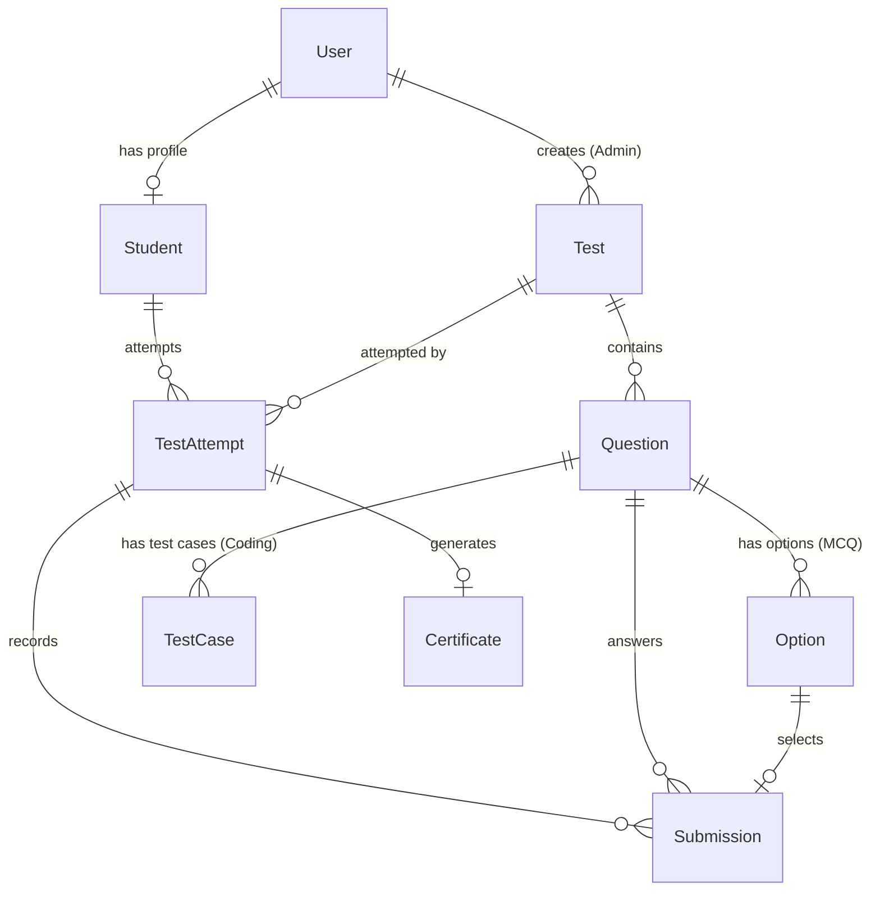

# 🚀 PyAssessPro - Online Coding Test Platform
### Dasara Special Task 2026 | 10000 Coders

An enterprise-grade, responsive online assessment platform built with **Python, Django, MySQL / SQLite, HTML5, CSS3, Bootstrap 5, and JavaScript**. PyAssessPro empowers instructors to create timed multiple-choice (MCQ) and algorithmic Python coding challenges with isolated test-case sandboxing, instant grading, interactive analytics, consistent tie-breaking leaderboards, and verified digital PDF certificate generation.

---

## 🌟 Key Highlights & Features

### 1. 🛡️ Admin & Instructor Module
- **Instructor Dashboard:** Real-time analytics of tests, student enrollment, submission volumes, and platform average score.
- **Assessment Management:** Full CRUD capabilities for tests (set duration, total marks, passing threshold, status).
- **MCQ Builder:** Add multiple-choice questions with 4 options and designated correct answers.
- **Python Coding Question Builder:** Add programming challenges with customizable constraints, starter code templates, visible **sample test cases**, and private **hidden test cases**.
- **Results & Reporting:** View complete student submission history and export comprehensive grade sheets to **CSV**.

### 2. 🎓 Student Assessment Module
- **Role-based Authentication:** Separate registration and login workflows with custom profile details (Roll Number, College, Branch, Phone).
- **Timed Exam Experience:**
  - Live floating countdown timer with visual low-time warning.
  - Automatic submission upon timer expiry.
  - Interactive Question Palette (visualizing Answered, Unanswered, and Current questions).
  - Background AJAX autosave for every response.
- **Interactive Python Code Editor:**
  - Tab indentation support, monospace syntax styling.
  - One-click **"Run Sample Test Case"** executing in an isolated sandbox with instant terminal feedback.
  - Starter code reset capability.
- **Detailed Results Breakdown:**
  - Question-by-question review of submitted answers vs. correct answers.
  - Editorial explanations.
  - Detailed test case pass/fail reports.

### 3. 🏆 Leaderboard Module
- **Top 10 Performers:** Hall of fame displaying ranks with custom Gold (#1), Silver (#2), and Bronze (#3) badges.
- **Consistent Tie-Breaking Algorithm:**
  1. Primary: Highest Score.
  2. Secondary: Lowest Time Taken (`time_taken_seconds`).
  3. Tertiary: Earlier completion timestamp (`completed_at`).
- **Assessment Filtering:** Filter rankings by specific tests or across all examinations.

### 4. ⚡ Advanced Extra-Credit Features
- **Negative Marking Engine:** Configurable penalty deductions for incorrect MCQ answers.
- **Question Randomization:** Unique question sequence shuffled for each student attempt.
- **Single Attempt Lock:** Prevents multiple submissions on strict examinations.
- **Performance Analytics:** Interactive visual charts powered by Chart.js tracking score progression.
- **Verifiable PDF Certificates:** Automatically generated landscape certificates for top-performing students (>=60%) generated dynamically with `fpdf2`.
- **Isolated Code Execution Sandbox:** Subprocess-isolated evaluation with AST static analysis blocking forbidden imports (`os`, `subprocess`, `socket`, `shutil`, `ctypes`, etc.) and system calls (`eval`, `exec`, `open`), enforcing a 3.0s timeout to thwart infinite loops.

---

## 🏗️ Architecture & Database Models



| Model | Purpose |
|---|---|
| `Student` | Student profiles linked to Django User with Roll Number, College, and Branch |
| `Test` | Test metadata, duration, marks, pass criteria, negative marking, randomization |
| `Question` | MCQ and Python Coding problem statements, constraints, and starter code |
| `Option` | Multiple choice options with correctness flag |
| `TestCase` | Sample and hidden stdin/stdout pairs for automated grading |
| `TestAttempt` | Student exam session, time spent, total score, percentage, status |
| `Submission` | Submitted choice or Python source code, test cases passed, awarded marks |
| `Certificate` | Verifiable digital certificate with unique UUID credential |

---

## 🚀 Quickstart & Setup Guide

### Prerequisites
- Python 3.10+
- Django 5.x
- (Optional) MySQL Server 8.0

### Step 1: Navigate to Project Directory
```powershell
cd C:\Users\HP\.gemini\antigravity\scratch\online_coding_platform
```

### Step 2: Install Dependencies
```powershell
pip install -r requirements.txt
```

### Step 3: Run Database Migrations
```powershell
python manage.py makemigrations
python manage.py migrate
```

### Step 4: Seed Sample Data
Populate the database with pre-built tests, questions, students, and leaderboard records:
```powershell
python populate_sample_data.py
```

### Step 5: Start Development Server
```powershell
python manage.py runserver
```
Visit **http://127.0.0.1:8000** in your web browser!

---

## 🗄️ Database Configuration (SQLite vs MySQL)

By default, the platform runs on **SQLite** out of the box for immediate zero-friction development.

To switch to **MySQL**:
1. Create a MySQL database:
   ```sql
   CREATE DATABASE coding_platform_db CHARACTER SET utf8mb4 COLLATE utf8mb4_unicode_ci;
   ```
2. Set environment variables in PowerShell:
   ```powershell
   $env:USE_MYSQL="True"
   $env:DB_NAME="coding_platform_db"
   $env:DB_USER="root"
   $env:DB_PASSWORD="your_mysql_password"
   $env:DB_HOST="127.0.0.1"
   $env:DB_PORT="3306"
   ```
3. Run migrations:
   ```powershell
   python manage.py migrate
   python populate_sample_data.py
   ```

---

## 🔑 Default Credentials

| Role | Username | Password | Notes |
|---|---|---|---|
| **Administrator** | `admin` | `admin123` | Full access to Instructor Console & Django Admin |
| **Student 1** | `rahul` | `student123` | Rank 1 (100% score, 820s completion) |
| **Student 2** | `priya` | `student123` | Rank 2 (90% score, 940s completion) |
| **Student 3** | `sai` | `student123` | Rank 3 (90% score, 1150s completion - tie-break) |
| **Student 4** | `ananya` | `student123` | Unattempted student profile ready for test taking |

---

## 🧪 Automated Testing
Run the automated test suite verifying sandbox security, timeouts, negative marking, and PDF generation:
```powershell
python manage.py test
```

---

## 📢 LinkedIn Post Template

```markdown
🚀 Excited to share my latest full-stack project built for the Dasara Special Task 2026 with 10000 Coders!

Introducing **PyAssessPro - An Online Coding Test Platform** built with Python, Django, MySQL, HTML5, Bootstrap 5, and JavaScript! 💻✨

Key Features implemented:
🔹 Admin Module: Complete test creation suite for Python MCQs and Coding Challenges with test-case configuration.
🔹 Secure Code Sandbox: AST-guarded, isolated Python execution engine with timeouts and safety constraints (no server execution vulnerability!).
🔹 Timed Exam Engine: Live auto-submit countdown timer, background autosave, question navigator, and code editor.
🔹 Real-time Leaderboard: Consistent tie-breaking algorithms highlighting top performers.
🔹 Verifiable PDF Certificates: Automated digital credentials for top scorers.
🔹 Visual Analytics: Interactive Chart.js score dashboards and CSV export.

A big thank you to the mentors and community at @10000 Coders for the guidance and inspiring challenge!

#Python #Django #WebDevelopment #FullStack #Bootstrap #EdTech #CodingAssessment #10000Coders #DasaraTask2026
```
